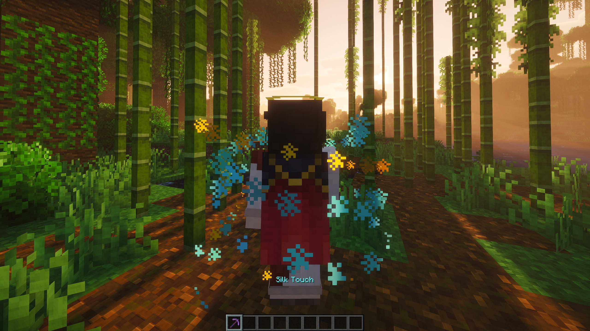
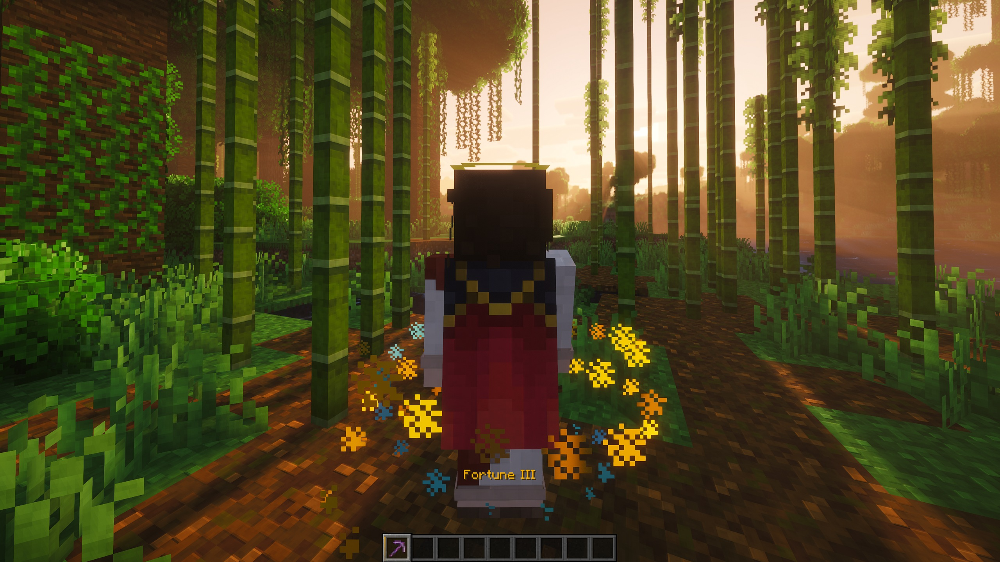

# Silk Switch

A Fabric mod for Minecraft. Press **G** to switch the tool in your hand between **Fortune** and **Silk Touch**. No second pickaxe, no anvil. [MODRINTH LINK](https://modrinth.com/mod/silk-switch)

  
  

## How it works

- Hold a tool that has Fortune or Silk Touch and press **G**.
- Fortune turns into Silk Touch. Press again and Fortune comes back at the same level it had before. The tool remembers it, including levels above III from other mods.
- Works on any tool with either enchantment: pickaxes, shovels, axes and hoes.
- You can change the key in **Options → Controls → Key Binds → Silk Switch**.

### No free Fortune

A tool that only ever had Silk Touch can't switch to Fortune. Silk Switch only gives back Fortune the tool really had, so it never turns a Silk Touch pickaxe into a Fortune III one.

If you'd rather allow it, turn on **Fortune on Silk-only tools** in the settings and pick the Fortune level those tools get.

## Settings

With [Mod Menu](https://modrinth.com/mod/modmenu) installed, open **Mods → Silk Switch → settings button**. Without Mod Menu, bind the **Open Silk Switch settings** key in Controls.

- **Fortune ⇄ Silk Touch:** turns the swap on or off.
- **Fortune on Silk-only tools:** off by default. When on, tools that never had Fortune can switch to Fortune.
- **Fortune Level:** appears when the option above is on. Picks the level those tools get, from I to X (higher if a data pack raises Fortune's max level).

Settings are saved per player in `config/silkswitch.json`. On a server, each player's own settings apply to them.

## What you see

- The new enchantment's name slides in above the hotbar, **Silk Touch** in aqua or **Fortune III** in gold, pushing the old name up and out.
- The tool's hotbar slot flashes the same color, and a spark runs once around it.
- Three strands of dust spiral up around you: the old enchantment's color spreads out while the new one's closes in.
- An amethyst chime plays, higher for Silk Touch. Other players nearby hear it; the visual effects only show on your screen.
- The tool stays in your hand while it switches, with no re-equip animation.
- A half-second cooldown stops accidental double presses.

## Requirements

- [Fabric Loader](https://fabricmc.net/use/)
- [Fabric API](https://modrinth.com/mod/fabric-api)
- Optional: [Mod Menu](https://modrinth.com/mod/modmenu) for the settings button

## Install

Download the jar for your Minecraft version from [Releases](../../releases) and put it in your `mods` folder.

- **Singleplayer:** that's all.
- **Multiplayer:** the server needs it too, because the swap happens on the server.

## Safe to remove

The remembered Fortune level is stored as plain vanilla item data. If you remove the mod, your tools keep whichever enchantment they had at the time and load normally.

## License

[MIT](LICENSE)
